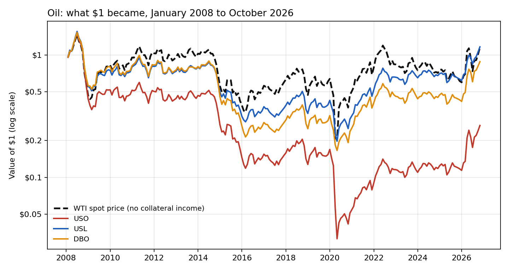
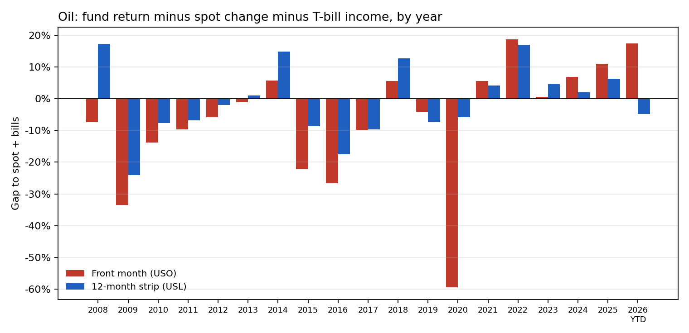
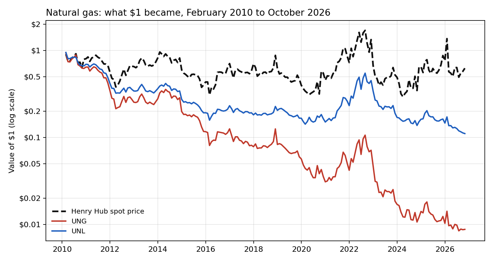
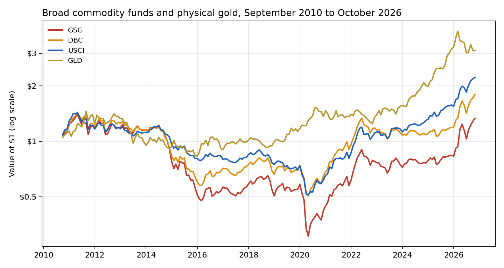
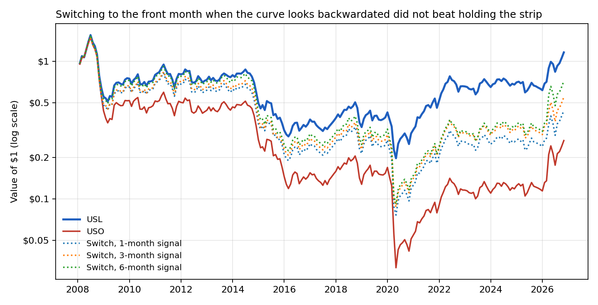

# The roll is the return: what commodity funds actually delivered against the spot price, 2008–2026

**Question.** With oil back above $100, many portfolios are adding commodities as an inflation hedge. They usually do it through futures-based funds, so they hold contracts that must be rolled before expiry, never the barrel itself. How much of the spot price move does each way of holding futures actually deliver? Does the answer depend on the shape of the futures curve? And how should an investment committee choose the vehicle?

**Answer, on real data.** From January 2008 to October 2026, WTI crude rose 14.7% and a T-bill account earned 1.5% a year.

- **Oil.** A fund that holds only the front-month contract (USO) returned −6.8% a year: $100M became $26.5M. A fund that spreads the position across the next 12 contracts (USL) returned +0.8% a year: $100M became $116.2M. Measured against the spot change plus T-bill income, the front month lost 8.8% a year to rolling and fees, the 12-month strip 1.4% and an optimum-yield fund (DBO) 2.8%.
- **Natural gas** was worse. Front-month UNG lost 24.6% a year from February 2010, against 2.8% a year for the Henry Hub price: $100M became $0.9M. The 12-month strip (UNL) lost 12.3% a year.
- **Backwardation (2026).** When the curve slopes downward, the front month wins. In 2026 to date USO returned +132.5%, against +92.1% for spot and +88.5% for USL.
- **Timing the curve shape did not help.** A pre-specified rule held the front month only after its realised roll had been positive, and the strip otherwise. At every lookback (1, 3 and 6 months) it returned between −4.3% and −1.7% a year, against +0.8% for simply holding the strip.
- **Broad baskets, September 2010 to October 2026.** The backwardation-tilted USCI returned 5.1% a year, the optimum-yield DBC 3.7% and the front-weighted S&P GSCI fund (GSG) 1.8%. All three returned between +19% and +29% in 2022, when the S&P 500 fell 18%.

Full write-up: https://www.guptagaurav.info/articles/commodity-roll-cost

## Results

| Oil, Jan 2008 – Oct 2026 (226 months) | How it holds futures | Return a year | Gap to spot + T-bills, a year | $100M became | Worst drawdown | Beta to spot (R²) |
|---|---|---|---|---|---|---|
| WTI spot (EIA) | n/a | +0.7% | n/a | $114.7M (price only) | n/a | n/a |
| USO | Front month | −6.8% | −8.8% | $26.5M | −97.9% | 0.85 (0.85) |
| USL | 12-month strip | +0.8% | −1.4% | $116.2M | −87.3% | 0.65 (0.84) |
| DBO | Optimum yield | −0.7% | −2.8% | $88.0M | −89.1% | 0.65 (0.79) |

| Natural gas, Feb 2010 – Oct 2026 (201 months) | How it holds futures | Return a year | Gap to spot + T-bills, a year | $100M became |
|---|---|---|---|---|
| Henry Hub spot (EIA) | n/a | −2.8% | n/a | $62.4M (price only) |
| UNG | Front month | −24.6% | −23.7% | $0.9M |
| UNL | 12-month strip | −12.3% | −11.2% | $11.1M |

| Broad funds, Sep 2010 – Oct 2026 | Design | Return a year | Volatility | Worst drawdown | Sharpe | 2022 | 2026 YTD |
|---|---|---|---|---|---|---|---|
| GSG | S&P GSCI, near contracts, energy-heavy | 1.8% | 21.4% | −78.2% | 0.12 | +24.1% | +60.6% |
| DBC | Optimum yield, 14 commodities | 3.7% | 17.3% | −64.8% | 0.20 | +19.3% | +50.6% |
| USCI | Backwardation-tilted selection | 5.1% | 14.8% | −64.0% | 0.30 | +29.5% | +43.7% |
| GLD (reference: physical gold, no roll) | n/a | 7.3% | 16.7% | −42.9% | 0.41 | −0.8% | −4.2% |

| Pre-specified switching rule (oil) | Return a year | Share of months in the front month | Switches |
|---|---|---|---|
| Always front month (USO) | −6.8% | 100% | 0 |
| Always 12-month strip (USL) | +0.8% | 0% | 0 |
| Switch on the 1-month signal | −4.3% | 36% | 74 |
| Switch on the 3-month signal | −3.1% | 38% | 36 |
| Switch on the 6-month signal | −1.7% | 40% | 21 |

After a positive trailing 3-month roll, the front month still trailed the strip the following month, by 0.49% on average (86 months). After a negative one it trailed by 0.28% (137 months).







## Method

- **Total returns.** Each fund's daily closing prices are split-adjusted, and every cash distribution is added back on its ex-date. Daily returns are compounded to month-ends. A data check stops the run if any daily move exceeds 50%, which would point to an unadjusted split.
- **Spot.** WTI Cushing and Henry Hub daily spot prices from the U.S. Energy Information Administration, at month-end.
- **Gap to spot plus T-bills.** The fund return minus the spot price change minus the income on 3-month Treasury bills. Futures funds hold T-bills as collateral, so this gap isolates what rolling and fees cost or earned. It is measured in log terms so that volatility does not bias it, then annualised.
- **Switching rule.** At each month-end, hold the front-month fund next month if its trailing realised gap (1, 3 or 6 months) was positive, which is the signature of a backwardated curve; otherwise hold the 12-month strip. Each switch costs 10 basis points. The rule and all three lookbacks were fixed before results were examined, and all three are reported.
- **Subperiods.** Gaps for 2008–2016 and 2017–2026 are reported in `reports/metrics.json`.

## Limits

- **Proxies.** The funds stand in for the underlying futures strategies. Their returns include management fees (roughly 0.6% to 1.1% a year) and fund-specific trading choices, such as USO's 2020 move into later contracts after the negative-price episode.
- **Fund rule changes.** Index methodology and fund rules have changed over time.
- **Spot is not investable.** Nobody can hold the spot price without storage, so the spot line is a reference, not an alternative.
- **One commodity cycle in each window**, and one oil shock still under way.
- **Not covered.** The test does not model institutional futures programmes with their own roll schedules and costs, and it does not test inflation-hedging effectiveness against CPI.
- Independent research on public data. It is not investment advice and has not been deployed.

## Data and citations

Data
- WTI Cushing daily spot price: U.S. Energy Information Administration (series RWTC). Copy used: [github.com/datasets/oil-prices](https://github.com/datasets/oil-prices) (data/wti-daily.csv; ODC-PDDL-1.0).
- Henry Hub natural gas daily spot price: U.S. Energy Information Administration (series RNGWHHD). Copy used: [github.com/datasets/natural-gas](https://github.com/datasets/natural-gas) (data/daily.csv; ODC-PDDL-1.0).
- Fund prices, distributions and 3-month Treasury yields: Yahoo Finance and US Treasury. Copy used: [huggingface.co/datasets/defeatbeta/yahoo-finance-data](https://huggingface.co/datasets/defeatbeta/yahoo-finance-data) (ODC-BY).
- All files are pinned by sha256 in `configs/default.yaml`.

Methods referenced
- Gorton, G. and Rouwenhorst, K. G. (2006). "Facts and Fantasies about Commodity Futures." *Financial Analysts Journal* 62(2), 47–68. [doi.org/10.2469/faj.v62.n2.4083](https://doi.org/10.2469/faj.v62.n2.4083)
- Erb, C. B. and Harvey, C. R. (2006). "The Strategic and Tactical Value of Commodity Futures." *Financial Analysts Journal* 62(2), 69–97. [doi.org/10.2469/faj.v62.n2.4084](https://doi.org/10.2469/faj.v62.n2.4084)

Code, analysis, charts and text were produced with AI assistance (Claude, by Anthropic) and reviewed by Gaurav Gupta.

## Run it

```bash
pip install -r requirements.txt
make all     # downloads the pinned files, verifies sha256, runs the pipeline
make test
```

Outputs: `reports/metrics.json`, `reports/monthly_returns.csv` and `reports/figures/`. Architecture: [docs/ARCHITECTURE.md](docs/ARCHITECTURE.md).

*Independent research on public data. Not investment advice. Dollar figures are illustrative.*
